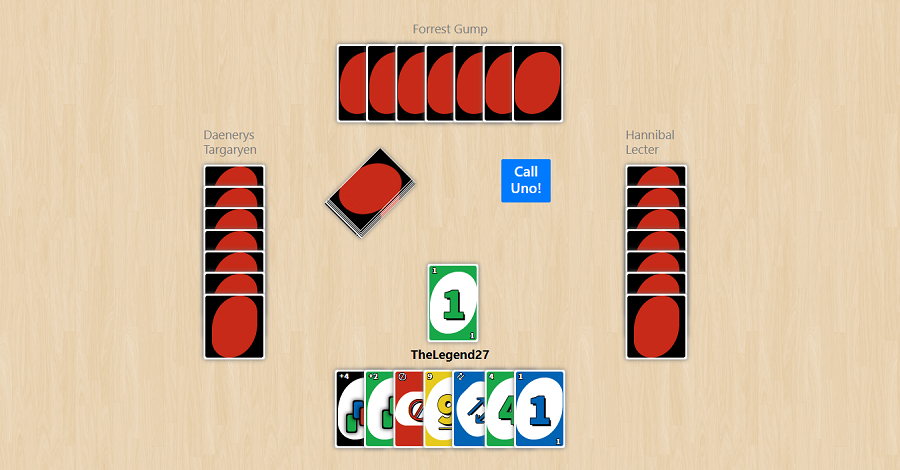

<h1 align="center">
  
</h1>

# Uno

This is a browser-based UNO game with one unified menu for local games against bots and online multiplayer. Online rooms open inside the main game instead of sending players to a separate game page.

## Play online locally

1. Install Node.js 20 or newer.
2. Run `npm ci --prefix server`.
3. Run `npm run start:online` in this folder.
4. Open `http://localhost:3001/health` to verify the server, then serve this folder from a local web server and open `index.html`. For example, run `npx http-server .` from this folder and use the URL it prints.
5. Choose **Play online** from the unified menu, connect with a guest name, create a private/public room, and share its six-character code.

Rooms support two to four seats. Bot opponents are optional and off by default; enable them when creating a room or from the host controls while waiting. When the host starts, bots fill every open seat, so one person can start a solo game against bots or a group can top up a partially filled room. The server owns the shuffled hands, bot turns, and move validation; each browser only receives its own cards. The lobby browser reconnects after transient connection drops and stays up to date as public rooms are created or closed. Players can reconnect to a room for 90 seconds, chat, call UNO, and vote together for a rematch. Solo bot games can be rematched by the human player. Game state is in memory and rooms expire after 30 minutes.

## Deploy online

`render.yaml` describes the free `openboard-uno-2026` WebSocket service on Render and configures the Openboard Supabase project URL and browser-safe publishable key for shared account registration and sign-in. Deploy this project as a Git repository, then create or sync the web service from its Blueprint. The production config uses `wss://openboard-uno-2026.onrender.com/ws`; local development continues to use `ws://localhost:3001/ws`. Render's free service may sleep when idle, so the first connection after inactivity can take a little longer. The publishable key is intended for browser use; never add a Supabase `service_role` or secret key to the site or repository. `UNO_ALLOWED_ORIGINS` is set to the GitHub Pages origin. Guest play does not require Supabase. New account confirmation emails return to the Openboard Chess site, whose URL must be enabled in the Supabase redirect allowlist.

Publish the static game files (including `index.html`, `launcher.js`, `launcher.css`, `online.html`, `online.js`, `online.css`, `uno-config.js`, `cards.css`, `retina_wood.png`, and `uno card back.png`) on a static host such as GitHub Pages. Online play requires serving the page over HTTP/HTTPS; opening the HTML directly as `file://` can block browser connections.

The online version preserves the current house rules: same-type draw-card stacking, drawing when no card is playable, and calling UNO at two cards before playing. Bot filling is an opt-in room setting and does not change computer-mode games.

## Tests

Run `npm run test:online` to test the server-authoritative UNO rules, private-hand snapshots, human multiplayer, solo bot games, bot turns, and rematches. Run `npm test --prefix server` for the same focused server tests.

## Contents

- [How to Start the Game](#how-to-start-the-game)
- [Play Online](#play-online-locally)
- [Development](#development)
- [Credits](#credits)

## How to Start the Game

Open `index.html` in a browser to play locally. Online rooms require serving the files over HTTP/HTTPS and running the online server as described above.

## Development

Want to contribute? Great!

To fix a bug or add an enhancement, follow these steps:

- Fork the repo
- Create a new branch (`git checkout -b improve-feature`)
- Make the appropriate changes in the files
- Add changes to reflect the changes made
- Commit your changes (`git commit -am 'Improve feature'`)
- Push to the branch (`git push origin improve-feature`)
- Create a Pull Request

## Credits

CSS for uno cards based off [a pen by rn404 on codepen.com](https://codepen.io/rn404/pen/mEpiG) containing CSS for cards 0-10
